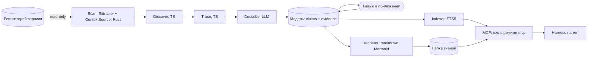

# 01. Архитектура

Десктоп-приложение на **Tauri 2**: фронтенд React/TypeScript, бэкенд Rust — тот же стек и те же правила, что в worklog-tracker. Kotlin + Spring Boot — это не стек хаба, а первый тип **анализируемых** репозиториев.

Стиль: **порты и адаптеры**. Доменная модель и логика пайплайна не знают ни про файловую систему, ни про конкретную LLM, ни про язык анализируемого кода. Всё внешнее — за интерфейсами; реализации собираются в реестры (как `COLLECT_STEPS` в worklog-tracker).

## Разделение ответственности

| Слой | Где | Что делает |
|---|---|---|
| UI | `src/components/` | экраны: репозитории, запуск и лог анализа, фичи, поток, диаграммы, ревью, настройки |
| Логика | `src/lib/` (TS, без React) | `runAnalysis()` и стадии Discover/Trace/Describe/Assemble, слияние с прошлой моделью, политики ревью, рендереры markdown/Mermaid |
| Вызовы бэкенда | `src/api.ts` | единственное место с `invoke`; одна функция на команду Rust |
| Бэкенд | `src-tauri/src/` (Rust) | чтение репозитория (только чтение), экстракторы и контекстные источники (Scan), хранилище знаний, SQLite (запуски, очередь ревью, FTS-индекс), LLM-клиент, секреты, MCP-сервер |

Почему так: разбор кода (tree-sitter) и файловый ввод-вывод естественны для Rust; оркестрация, эвристики группировки и рендер — для TS, как в worklog-tracker. MCP-сервер должен работать без окна, поэтому он в Rust и читает уже сохранённые знания и индекс.

## Модули

### Фронтенд `src/`
- `types.ts` — доменная модель (зеркало `src-tauri/src/model/`): Service, Feature, Trigger, Component, Step, Sink, Edge, Claim, Evidence, ReviewItem.
- `lib/pipeline.ts` — `runAnalysis()`: только оркестрация стадий, чекпойнты после каждой.
- `lib/stages/` — по файлу на стадию; реестр `STAGES`.
- `lib/model/` — построение claims, стабильные id, слияние с прошлой моделью, статусы.
- `lib/review/` — `ReviewPolicy` (строгая, мягкая), реестр политик, сценарии ревью.
- `lib/render/` — `Renderer`-ы (markdown, Mermaid L1–L3), реестр `RENDERERS`.
- `i18n/` — ru/en, как в worklog-tracker.

### Бэкенд `src-tauri/src/`
- `repo.rs` — снимок репозитория только для чтения: список файлов, чтение, коммит из `.git`, запрет путей вне корня.
- `extract/` — трейт `Extractor` и реестр; `extract/kotlin_spring/` — первый экстрактор (tree-sitter-kotlin).
- `context/` — трейт `ContextSource` и реестр: `application.yml`, OpenAPI, миграции, CODEOWNERS.
- `store/` — `KnowledgeStore` на локальной папке (YAML, раскладка из `07-storage.md`).
- `state.rs` — SQLite в `.state/`: запуски, чекпойнты, лог, очередь ревью, журнал.
- `index/` — `Indexer` на SQLite FTS5.
- `llm.rs` — OpenAI-совместимый клиент (повтор без `response_format`, как в worklog-tracker).
- `mcp/` — MCP-сервер по stdio; код инструментов отделён от транспорта.
- `commands/` — Tauri-команды по областям; `error.rs` — `AppError { code, params }`; `settings.rs`, `secrets.rs` (keyring).

## Общий поток

## Расширение

Любая ось расширяется новой реализацией интерфейса и записью в реестр (см. `05-extension-points.md`). Стадии пайплайна не знают конкретных реализаций.

## Запуски

Анализ может быть долгим, поэтому:

- запуск (`Run`) — сущность с id, стадиями и статусами, хранится в SQLite;
- после каждой стадии состояние сохраняется (чекпойнт);
- упавший запуск возобновляется с первой незавершённой стадии;
- Trace по фичам выполняется параллельно.

## Конфигурация

`settings.json` (как в worklog-tracker): папка знаний, язык, LLM (адрес, модель), политика ревью, список репозиториев. Секреты (токен LLM) — в keyring, не попадают в файлы знаний и логи; значения редактируются до отправки в LLM.

## Нефункциональное

- Воспроизводимость: те же входы (коммит + версия экстрактора + промпты) дают сопоставимую модель; версии пишутся в метаданные запуска.
- Наблюдаемость: лог стадий (info/ok/warn/error) с кодами, отображается в приложении.
- Безопасность: хаб читает только выбранный репозиторий; пути за его пределами недоступны.
