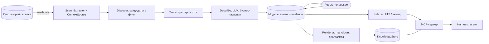

# 01. Архитектура

Стиль: **порты и адаптеры** (hexagonal). Ядро (`kb-domain`) не знает ни про Spring, ни про файловую систему, ни про LLM. Всё внешнее подключается через интерфейсы из `kb-ports`; реализации собираются Spring-ом как `List<Port>`.

## Модули

| Модуль | Роль | Зависит от |
|---|---|---|
| `kb-domain` | модель знаний: Feature, Trigger, Step, Component, Sink, Claim, Evidence, ReviewItem | — |
| `kb-ports` | интерфейсы (SPI) | `kb-domain` |
| `kb-pipeline` | оркестрация стадий, `RunContext`, сохранение и возобновление запусков | ports, domain |
| `kb-extractor-kotlin-spring` | экстрактор Kotlin + Spring Boot | ports, domain |
| `kb-llm-openai` | OpenAI-совместимый клиент (корпоративный шлюз) | ports |
| `kb-store-fs` | хранилище знаний в локальной папке | ports, domain |
| `kb-index-sqlite` | FTS5-индекс | ports, domain |
| `kb-render-markdown` | markdown и Mermaid из модели | ports, domain |
| `kb-review` | политики и сценарии ревью, HTTP API для UI | ports, domain |
| `kb-mcp` | MCP-сервер | ports, domain |
| `kb-app` | Spring Boot: wiring, конфигурация, CLI | все |

Правило зависимостей: адаптеры знают только `kb-ports` и `kb-domain`; `kb-domain` не зависит ни от чего; только `kb-app` видит все модули.

## Общий поток

## Расширение

Любая ось расширяется добавлением модуля с реализацией порта (см. `05-extension-points.md`). Включение — наличием бина в classpath и настройкой в `application.yml`. Стадии пайплайна не знают конкретных реализаций.

## Запуски

В отличие от короткого in-memory запуска worklog-tracker, анализ может быть долгим. Поэтому:

- запуск (`Run`) — сущность с id, стадиями и статусами, хранится персистентно;
- каждая стадия идемпотентна и пишет результат в хранилище запусков;
- упавший запуск возобновляется с первой незавершённой стадии;
- параллельно можно анализировать разные фичи (стадия Trace по фичам).

## Конфигурация

`application.yml` + переменные окружения. Секреты (токен LLM) не попадают в файлы знаний и логи; значения редактируются до отправки в LLM.

## Нефункциональное

- Воспроизводимость: те же входы (коммит + версия экстрактора + промпты) дают сопоставимую модель; версии пишутся в метаданные запуска.
- Наблюдаемость: лог стадий в стиле `RunContext.log` из worklog-tracker (info/ok/warn/error), доступен в UI.
- Безопасность: хаб читает только то, что указано в настройках; пути за пределами репозитория недоступны.
